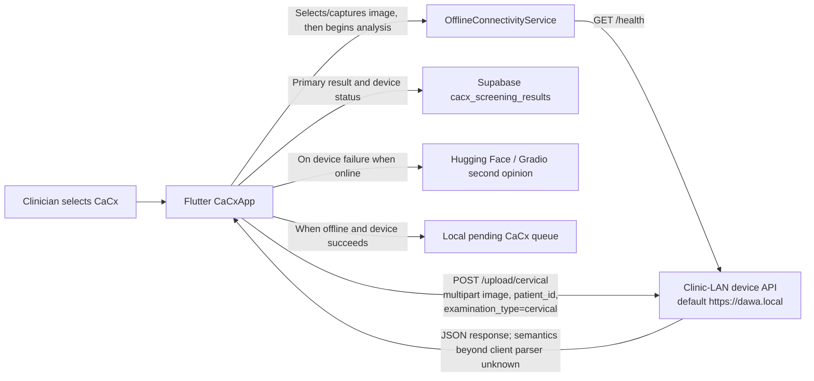
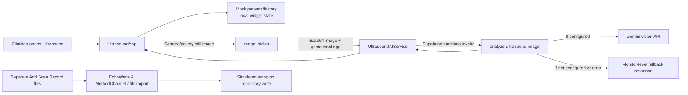
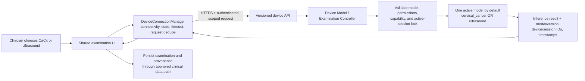

# Dawa Clinician × Edge Device Communication Architecture Audit

## Executive summary

**Verified:** CaCx has a direct, client-side HTTP API integration with one configured clinic-LAN device URL. After the clinician selects an image, the app checks `GET /health`, then sends the image as multipart form data to `POST /upload/cervical`. The default base URL is `https://dawa.local`; build-time overrides are supported. A successful health response means only that the endpoint returned a 2xx response. The app does not request, inspect, or confirm an AI model.

**Verified:** Ultrasound does not use this CaCx device API. Its AI analysis sends a still image to the Supabase Edge Function `analyze-ultrasound-image`, which calls Gemini when configured. Patient and scan-history data in the Ultrasound dashboard are populated from mock data and scan results are held in widget state. A separate EchoWave A flow exists, but its save operation is explicitly a simulated delay and no native implementation of its declared method channel was found in the Android or iOS platform source.

**Unknown:** The edge-device server/firmware, model runtime, model mapping, readiness semantics, authentication, and switching behavior are not in this repository. Therefore, the app cannot currently verify that CaCx requests activate a cervical model, nor can it safely request or confirm an ultrasound model.

**Recommendation:** Do not activate a model on module navigation or patient selection. Request a model only after a clinician explicitly begins an examination, after a patient and workflow are established. The device must serialize activation and examination work, return model/version/readiness, and reject switching while an examination is active. Treat the current CaCx upload contract as a compatibility path until a device-side API and migration plan are agreed.

This report is an investigation and architecture proposal only; it does not implement these changes.

## Scope and evidence labels

This audit followed the Flutter app, Supabase function, Android/iOS platform source, tests, and existing device-integration documentation. No physical device or separate edge-device repository was available.

- **Verified** — directly confirmed in repository source or tests.
- **Inferred** — suggested by the client contract, but not confirmed by device implementation.
- **Unknown** — requires the device repository, deployed service, or hardware to confirm.
- **Proposed** — a recommendation for future work, not an existing API or behavior.

No patient-specific values, credentials, or tokens are included in this report.

## Current system architecture

### CaCx device path



**Verified:** The device request is direct from Flutter to the configured local base URL; no Supabase proxy is used for the CaCx image upload. The app uses ordinary HTTP client requests over the URL scheme configured at build time. The default is HTTPS, and the integration documentation describes the device as a clinic-LAN API. The CaCx code does not use WebSockets, MQTT, or a serial connection.

### Ultrasound cloud and capture paths



**Verified:** Ultrasound's cloud analysis is distinct from the direct CaCx device path. It does not call `/health`, `/upload/cervical`, or `PiDeviceConfig.uploadUrlFor`. The separate EchoWave path is not the AI-analysis path.

## Verified CaCx communication flow

### Entry and request initiation

1. **Opening the module does not activate or health-check a device.** `getCareToolSummaries()` wires the CaCx tile to `CaCxApp`. `CaCxApp.initState()` loads its data and attempts to sync pending CaCx rows; the local device is checked only after an image is selected and `_analyzeImage()` starts. With `autoStartScreening`, opening the widget opens the image-source picker, but the device request still follows image selection.
2. `_openImageSourcePicker()` blocks another CaCx upload while the current analysis/upload is active. Once an image is selected, it records the image and invokes `_analyzeImage()`.
3. `_analyzeImage()` calls `OfflineConnectivityService.refreshStatus(checkDevice: true)`. The route decision prioritizes a reachable device, uses the online fallback when the device is unavailable and internet is available, and uses offline-only behavior when neither is available. In the non-offline path the app attempts the device request first; the online second-opinion path follows when the device result is unsuccessful.

Relevant source: [`care_tool_registry.dart`](../lib/application/care_tools/care_tool_registry.dart#L11), [`cacx_widget.dart`](../lib/application/cacx/cacx_widget.dart#L359), [`cacx_widget.dart`](../lib/application/cacx/cacx_widget.dart#L577), [`cacx_widget.dart`](../lib/application/cacx/cacx_widget.dart#L608), [`offline_connectivity_service.dart`](../lib/services/offline_connectivity_service.dart#L66).

### Device URL and endpoints

| Request | Status in this repository | Client behavior |
|---|---|---|
| `GET {base}/health` | **Verified client request** | Any 2xx is treated as reachable. Five-second default timeout. The response body is not interpreted as model readiness. |
| `POST {base}/upload/cervical` | **Verified client request** | Multipart image upload, with a 120-second default overall upload timeout. |
| `POST {base}/upload/ultrasound` | **Not called by Ultrasound** | Mentioned as a possible path in older integration documentation only; not an implemented Ultrasound integration. |
| Model activate/status/capabilities API | **Not found** | No model-selection or model-readiness request is made by this client. |

`PI_DEVICE_BASE_URL` defaults to `https://dawa.local`; `CERVICAL_DEVICE_BASE_URL` overrides the base specifically for CaCx. `PiDeviceConfig.uploadUrlFor()` can construct a generic upload URL, but it is not used by the Ultrasound module. Configuration and request code are in [`cacx_upload_service.dart`](../lib/application/cacx/cacx_upload_service.dart#L11) and [`cacx_upload_service.dart`](../lib/application/cacx/cacx_upload_service.dart#L47).

The health probe is implemented in [`OfflineConnectivityService.checkDeviceHealth`](../lib/services/offline_connectivity_service.dart#L166). It classifies network errors such as timeout, TLS/certificate, hostname, and browser transport failures, but it has no model-specific status. The actual upload is implemented in [`CervicalDeviceService`](../lib/application/cacx/cacx_upload_service.dart#L203).

### Data sent and returned

**Verified request fields:**

- `image`: image bytes, with a filename and MIME type derived from the selected image.
- `patient_id`: selected patient ID, or `unassigned`.
- `examination_type`: the literal `cervical`.

No `requested_model`, model version, device ID, examination/session ID, clinician authorization token, or idempotency key is added by the client request. The app does not ask the device to capture an image; a clinician selects/captures an image in the app and then uploads it.

The client parses JSON-ish response fields including `result`, `label`, `prediction`, `class`, `classification`, `diagnosis`, `interpretation`, `risk`, `risk_level`, and `status`, plus common confidence keys. It accepts a 2xx response with no `error`/`message` field as a successful device interpretation, even if a meaningful label is not returned. This is the client parser's behavior, not confirmation of the edge model's response contract.

**Inferred:** The `/upload/cervical` route and `examination_type=cervical` likely tell the device which examination path is intended. **Unknown:** Whether that route loads/selects the cervical model, assumes it is already loaded, or forwards to some separate model service.

### Result handling, failure, and storage

- The app checks `/health` before a normal online device upload. The offline-only flow checks it once in the routing step and skips the duplicate check in the upload helper.
- Device timeout, non-2xx HTTP response, or network error is represented as a failed device interpretation. When online, the app routes the same image to its Gradio/Hugging Face second-opinion service. In offline-only mode, a successful device result is queued locally for later Supabase sync; a failed device request returns the clinician to the dashboard with a disconnected/unavailable message.
- A successful or failed primary interpretation is saved to `cacx_screening_results` with fields such as primary result/confidence/raw response, risk, device endpoint/status/error, and second-opinion status. Failed Supabase writes are queued locally.
- No request cancellation, examination-session lease, device-side job status polling, resume/retry token, or model-switch lock is present in the client flow. During an upload, the UI prevents a second CaCx upload in that widget, but this is not a device-wide concurrency safeguard.

Relevant code: [`_analyzeImage`](../lib/application/cacx/cacx_widget.dart#L608), [`_analyzeImageOfflineOnly`](../lib/application/cacx/cacx_widget.dart#L701), [`_sendImageToDeviceOnce`](../lib/application/cacx/cacx_widget.dart#L768), [`_runCloudFallbackForCurrentScan`](../lib/application/cacx/cacx_widget.dart#L998), [`CacxScreeningResultsRepository`](../lib/application/cacx/cacx_upload_service.dart#L407).

### Authentication, authorization, and device identity

**Verified client facts:**

- The direct `/health` and multipart upload requests add no authorization or device-token header.
- The client has a single build-configured base URL; it has no device registry, device discovery, user-to-device assignment, or device ID selection.
- The URL defaults to HTTPS and existing integration docs require normal TLS validation, CORS for Flutter Web, and a trusted certificate. TLS can authenticate the server to the client if the certificate is trusted; it does not by itself prove the clinician is authorized to use the device.

**Unknown:** Whether the deployed device API independently enforces authentication, authorization, network allowlists, or clinician/device permissions. No such enforcement can be established from the client-only code. There is also no device identity or firmware identity in the request or saved result fields.

The app sends a patient identifier to the local device. Before production expansion, confirm whether the device needs this value; prefer a short-lived opaque examination identifier if patient identity is not required for device inference.

For the Ultrasound cloud path, the Edge Function source validates the HTTP method and image payload but contains no clinician/clinic role check. No function-specific `verify_jwt` entry for `analyze-ultrasound-image` was found in the checked `supabase/config.toml`; effective authentication/authorization must therefore be confirmed against the deployed Supabase configuration rather than inferred from the client call.

## Current Ultrasound implementation

| Feature | Repository evidence | Assessment |
|---|---|---|
| Dashboard, patient registry, scan history | `_loadData()` populates patients and history via `UltrasoundMockData`; no repository/database read is performed by this screen. | **Verified: demo/local state.** |
| Normal scan | `_startManualScan()` changes local workflow state. `_captureFromProbe()` uses `UltrasoundImagePickerService.captureImage()`, which opens the device camera. | **Partially implemented.** It does not acquire a frame from the Edge Device. |
| AI-Guided Scan | Provides guided sweep UI/state, but capture/gallery images use the same `_runAnalysis()` and `UltrasoundAIService` path as other scans. | **Partially implemented.** “AI-guided” is not a distinct edge model or API. |
| AI-assisted analysis | Calls Supabase Edge Function `analyze-ultrasound-image`; that function calls Gemini if `GEMINI_API_KEY` is configured. | **Implemented as a cloud path; deployment/model availability is environment-dependent.** |
| Missing Gemini configuration | The Edge Function returns a monitor-level fallback stating that model-assisted interpretation is not configured. | **Verified fallback, not inference.** A successful HTTP response alone must not be presented as a completed AI inference. |
| Malformed/unexpected successful response | Flutter `_parseResult()` catches parsing errors and returns `_mockResult()`, whose example findings/assessment are clinically substantive and normal. | **Verified demo fallback and a clinical provenance risk.** |
| Scan persistence | `_saveResult()` prepends a record to `_scanHistory` in widget state. It does not persist to Supabase. | **Verified: in-memory only.** |
| Add Scan Record / EchoWave A | `EchoWaveService` declares a MethodChannel, launches an external Android package, then scans local Pictures/Movies for files. `ScanRecordPage._saveRecord()` has a TODO repository call and simulated delay. | **Partially implemented / unverified.** |
| Native EchoWave bridge | The Dart side invokes `com.dawahealth.dawa_clinic/echowave`; no matching Android/iOS method-channel handler was found. Android `MainActivity` only extends `FlutterActivity`. | **Verified absence in checked platform source; actual installed-app behavior requires device validation.** |
| Ultrasound-to-edge model API | No invocation of the CaCx device API or model-management endpoint was found in the Ultrasound module. | **Verified: not integrated.** |

Key references: [`ultrasound_app.dart`](../lib/application/ultrasound/screens/ultrasound_app.dart#L63), [`ultrasound_app.dart`](../lib/application/ultrasound/screens/ultrasound_app.dart#L77), [`ultrasound_app.dart`](../lib/application/ultrasound/screens/ultrasound_app.dart#L235), [`ultrasound_app.dart`](../lib/application/ultrasound/screens/ultrasound_app.dart#L259), [`ultrasound_ai_service.dart`](../lib/application/ultrasound/services/ultrasound_ai_service.dart#L5), [`analyze-ultrasound-image`](../supabase/functions/analyze-ultrasound-image/index.ts#L31), [`ultrasound_image_picker_service.dart`](../lib/application/ultrasound/services/ultrasound_image_picker_service.dart#L6), [`echowave_service.dart`](../lib/application/ultrasound/services/echowave_service.dart#L60), [`scan_record_page.dart`](../lib/application/ultrasound/screens/scan_record_page.dart#L127), [`MainActivity.kt`](../android/app/src/main/kotlin/com/example/my_project/MainActivity.kt).

## Current API and AI architecture inventory

| Component | Current role | Evidence / boundary |
|---|---|---|
| Clinic-LAN device `GET /health` | CaCx reachability probe | Client only treats 2xx as reachable; not a model-ready contract. |
| Clinic-LAN device `POST /upload/cervical` | CaCx image inference request | Client multipart contract is implemented; server implementation is absent. |
| `PiDeviceConfig.uploadUrlFor(type)` | Generic URL construction helper | Does not itself create or prove a device endpoint exists; not used by Ultrasound. |
| Hugging Face / Gradio CaCx service | Online second opinion after local device failure or user action | Separate from edge-device primary request; called by `HuggingFaceService` in `cacx_widget.dart`. |
| Supabase `analyze-ultrasound-image` | Ultrasound cloud analysis endpoint | Validates image input, uses Gemini if configured, otherwise returns an explicit monitor fallback. No edge-device routing. |
| EchoWave A bridge | Launches a separate Android app and imports newly written media files | Separate acquisition/integration path; native method handler and real record persistence were not found. |
| Existing CaCx tests | Check risk mapping, URL defaults, and route priority | No HTTP contract, model management, concurrency, or hardware integration coverage. |

No edge-device implementation, model artifact, model-selection API, model runtime, or device deployment configuration was located in this repository. Existing docs describe a Pi/Arduino-style service contract but also state that the physical service is external. Treat device-side details as **Unknown** until verified with its source and deployed hardware.

## AI model management: current capability assessment

| Capability | Status | What source establishes |
|---|---|---|
| Explicit model selection | **Not implemented in app** | The request sends `examination_type=cervical`, not `requested_model`. No activation request exists. |
| Mapping CaCx route to a cervical model | **Inferred only** | `/upload/cervical` suggests a cervical path; device-side route-to-model mapping is unavailable. |
| Ultrasound edge model | **Not integrated** | Ultrasound invokes a Supabase cloud function, not the device. |
| Model load/unload, switching, active-model query | **Unknown** | Requires device code and/or API documentation. |
| Model readiness and initialization errors | **Unknown** | `/health` only yields a reachability result in this client. Upload errors are not model readiness errors. |
| Simultaneous model support and memory/compute constraints | **Unknown** | Do not assume both models can be resident or run simultaneously. |
| Preventing model switch during examination | **Not implemented client-side; device behavior unknown** | There is no shared session lock or examination lifecycle API. |
| Model provenance on results | **Incomplete** | CaCx saves a device endpoint/status and raw response, but no model name/version or device identity. Ultrasound results are in-memory. |

## Limitations and risks to resolve

1. **Reachability is not readiness.** The current `/health` check cannot tell the app which model is loaded, whether it is initialized, or whether the inference runtime can accept work.
2. **No safe switch contract.** Navigation, another clinician, or a second app instance could request work while an examination is active; the client-local CaCx upload guard cannot protect the device globally.
3. **No device request authentication shown.** Direct requests carry no auth headers. Device-side access controls need confirmation before the device handles more model types or patient data.
4. **No model/device provenance.** The current saved CaCx record cannot prove which model/version or physical device produced a result.
5. **Fallback provenance can be ambiguous.** CaCx may present a cloud second opinion after device failure. Ultrasound can receive a non-inference Edge Function fallback, and a Flutter parse exception can produce mock normal findings. Keep these sources and states explicit; do not label them as edge AI results.
6. **Clinical image acquisition differs by workflow.** Ultrasound AI currently analyzes camera/gallery still images. The separate EchoWave media-import path has a missing/unverified native bridge and a simulated save; it should not be treated as a working edge inference pipeline.
7. **Network and platform compatibility.** `dawa.local`, TLS trust, local-network permissions, and Flutter Web CORS/mixed-content behavior need verification on actual clinic devices. A reachable hostname alone does not establish a safe authenticated route.
8. **Patient data reaches the device.** CaCx includes `patient_id` with the image. Confirm necessity, retention, transport security, logging policy, and clinic network boundary before extending the upload to obstetric data.
9. **Fallback parsing accepts loose responses.** A 2xx response without a structured result/error can be treated as success. The device contract should be versioned and validated before expanding to ultrasound.
10. **Current tests are not integration tests.** `cacx_upload_routing_test.dart` checks default URL/timeouts and route decisions; it does not send an HTTP request to a device, assert model state, exercise a real edge runtime, or validate switching.

## Proposed multi-model architecture

### Recommendation

**Proposed:** Reuse the current clinic-LAN HTTPS path for edge inference rather than routing device model control through Supabase or introducing MQTT/WebSockets without a demonstrated requirement. Add one shared app-side `DeviceConnectionManager` used by CaCx and Ultrasound, and a device-side model/examination controller that owns model validation, serialization, readiness, lifecycle, and recovery.

Retain `/upload/cervical` as a compatibility route while old clients/device builds remain deployed. Do not silently change its meaning. Add a negotiated/versioned contract only after the device developer confirms supported API shape and rollout.

**Proposed endpoint concepts below are design candidates only. They do not exist in this repository and must not be implemented against until the edge-device developer confirms them.**

| Proposed capability | Candidate operation | Requirement |
|---|---|---|
| Device health/capability | `GET /health`, `GET /v1/capabilities` | Report device identity/version, supported models, concurrency policy, and service state separately from model readiness. |
| Model state | `GET /v1/models/status` | Include current/target model, version, readiness, load/error state, and active examination/session. |
| Activate model | `POST /v1/models/activate` with requested model and request/session ID | Device validates allowlist/capability, serializes requests, supports idempotent repeat calls, and refuses switching while a conflicting exam is active. |
| Begin examination / inference | `POST /v1/examinations` then examination-scoped image/frame submission | Bind model/version and device identity to a session; reject inference unless the session is ready and authorized. |
| Finish/cancel/recover | examination-scoped complete/cancel/status operations | Release the model lock only on a safe terminal state; define recovery after timeout, disconnect, or device restart. |

For initial rollout, assume **one active model per device**, unless the device developer proves concurrent model support and provides memory/compute admission control. Use explicit `busy/conflict`, `unsupported model`, and `initialization failed` outcomes rather than unloading an in-use model or falling back to an unlabelled model.

### Proposed architecture



### Safe activation point

**Proposed:** Resolve the requested model from the explicit workflow (`cervical_cancer` for CaCx, `ultrasound` for Ultrasound), but defer activation until the clinician has selected/confirmed the patient and taps **Begin examination**. This avoids module-navigation side effects and avoids loading a model for abandoned patient selection. Model activation must complete and return an explicit ready response before the app enables capture/upload.

While an examination is active, module navigation or selecting another model must not unload, replace, or interrupt its model. Keep the examination session alive, warn/block navigation when work is active, and provide a deliberate complete/cancel path. The device remains authoritative: it must reject conflicting activation requests even if the UI attempts to prevent them.

### Proposed request/readiness sequence

```mermaid
sequenceDiagram
  actor Clinician
  participant UI as Clinician app
  participant Manager as DeviceConnectionManager
  participant Device as Edge device API
  participant Runtime as Model runtime

  Clinician->>UI: Open CaCx or Ultrasound
  Note over UI,Device: Navigation and patient selection do not activate models
  Clinician->>UI: Select patient and tap Begin examination
  UI->>Manager: Begin(model, patient context, exam ID)
  Manager->>Device: GET /health and GET /v1/capabilities
  Device-->>Manager: Device reachable; capabilities and allowed models
  Manager->>Device: POST /v1/models/activate (requested model, request ID)
  Device->>Device: Validate model, authorization, and active-session lock
  alt Another exam holds a conflicting model
    Device-->>Manager: Busy/conflict; no model switch
    Manager-->>UI: Error/busy; keep exam capture disabled
  else Model needs initialization
    Device->>Runtime: Load requested model
    Runtime-->>Device: Ready or initialization error
    Device-->>Manager: Model status + model/version + device/session IDs
    Manager-->>UI: Ready or actionable error
  end
  UI->>Manager: Capture and submit examination image
  Manager->>Device: Examination-scoped inference request
  Device-->>Manager: Result + provenance
  Manager-->>UI: Display result and persist approved audit metadata
  Clinician->>UI: Complete/cancel examination
  UI->>Manager: Close examination session
  Manager->>Device: Complete/cancel session
```

## Implementation plan

### Phase 1 — Communication audit

**Deliverable:** This report captures the source-verified app behavior, existing service contracts, Ultrasound gap, risks, and device-developer questions. Confirm every **Unknown** with the device owner before API design.

### Phase 2 — Edge Model Controller

1. Agree on versioned device API, supported model identifiers, response schema, auth, TLS, timeouts, and error semantics.
2. Implement device-side allowlisting/capability reporting, model activation/readiness reporting, and model/version provenance.
3. Serialize activation and inference against examination sessions. Repeated identical requests should be safe/idempotent; conflicting switches during a live session should fail without unloading it.
4. Define initialization failure, disconnect/reboot recovery, cancellation, and request idempotency.
5. Verify the contract against the real device and model runtime before clinician-app integration.

### Phase 3 — Clinician integration

1. Add a shared connection/session manager instead of duplicating HTTP/model state in each screen.
2. Keep the CaCx legacy upload path working during migration; add model activation only after the device API is deployed and compatible.
3. Integrate Ultrasound with the device path only after the device confirms its image/frame format and model requirements. Keep its existing cloud path separately identified and governed.
4. Bind each examination request/result to a session and persist model, model version, device identity/version, timestamps, route/source, and correlation ID.
5. Do not send patient identifiers to the device unless required and approved; otherwise use an opaque session identifier.

### Phase 4 — Device status UI

Show explicit states at the examination surface: disconnected, checking device, loading model, ready, examination active, busy/conflict, and error. Disable capture/submit until readiness is confirmed. Explain whether a result came from the edge model, cloud fallback, mock/demo data, or manual review. Do not signal “ready” based only on `/health`.

### Phase 5 — Testing and validation

Start with contract/unit tests, then run integration tests against the actual edge device. Mocked tests are useful for deterministic failure paths but do not validate model loading, hardware timing, memory pressure, TLS, local network permissions, or real inference.

| Test | Required verification |
|---|---|
| CaCx model selection | CaCx begin request asks for `cervical_cancer`; returned active model/version matches before image submission. |
| Ultrasound model selection | Ultrasound begin request asks for `ultrasound`; edge path only enabled when device reports capability. |
| Switching between models | Sequential completed exams load the intended model and the next model is not used before readiness. |
| Repeated requests | Same activation/session request is idempotent and does not reload or create duplicate exams. |
| Failed initialization | UI remains not-ready; no inference is submitted; actionable error and audit event are recorded. |
| Device disconnection | During activation and inference, mark result/session state explicitly and do not synthesize success. |
| Network timeout | Bound wait, preserve request/session correlation, support safe status reconciliation before retry. |
| Concurrent requests | Two clients requesting different models are serialized; one receives busy/conflict, not an unsafe switch. |
| Switching during active exam | Model is not unloaded/replaced; device rejects switch and existing examination remains usable or recoverable. |
| Incorrect/unauthorized model | Unknown or unauthorized model IDs are rejected by device; client does not bypass this validation. |
| Existing CaCx preservation | Existing `/upload/cervical`, online second-opinion behavior, offline queueing, and result persistence remain covered through rollout. |
| TLS/CORS/network | Test trusted certificate, local-network permissions, browser CORS, host resolution, and connection recovery on deployed platforms. |
| Result provenance | Persist and display route, model/version, device identity/version, exam/session ID, and readiness/inference timestamps. |
| Real-device clinical validation | Validate representative images, model version, quality limits, outputs, and clinician-review workflow with clinical/device owners. |

Existing focused tests are in [`cacx_upload_routing_test.dart`](../test/cacx_upload_routing_test.dart#L8); they cover risk routing, configured URLs/timeouts, and routing preference only.

## Specific files for future work

No application files were changed for this audit. The following are likely touchpoints after the edge API is agreed:

| File / area | Future purpose |
|---|---|
| [`cacx_upload_service.dart`](../lib/application/cacx/cacx_upload_service.dart) | Preserve legacy endpoint, then route shared device health/capability/activation/session/inference calls through the manager. |
| [`offline_connectivity_service.dart`](../lib/services/offline_connectivity_service.dart) | Keep generic reachability distinct from model readiness; reuse only for connectivity. |
| [`cacx_widget.dart`](../lib/application/cacx/cacx_widget.dart) | Start model/session only on explicit examination begin; gate capture/upload and retain current fallback semantics with clear provenance. |
| [`ultrasound_app.dart`](../lib/application/ultrasound/screens/ultrasound_app.dart) | Replace demo patient/history state and wire explicit Ultrasound examination lifecycle after device contract exists. |
| [`ultrasound_ai_service.dart`](../lib/application/ultrasound/services/ultrasound_ai_service.dart) | Keep cloud inference distinct from edge inference and prevent mock outputs from being indistinguishable from real results. |
| [`ultrasound_image_picker_service.dart`](../lib/application/ultrasound/services/ultrasound_image_picker_service.dart) | Align supported capture/image input with device API; do not imply the phone camera is a probe feed. |
| [`care_tool_registry.dart`](../lib/application/care_tools/care_tool_registry.dart) | Keep module navigation free of model activation; route only to screens/services. |
| `lib/services/device_connection_manager.dart` (new, proposed) | Shared lifecycle, status, request deduplication, timeout, and state handling for both modules. |
| Shared device-status widget/state (new, proposed) | Show loading, ready, disconnected, busy, and error states consistently. |
| Supabase migration(s), after schema review | Add examination/session and model/device provenance to durable records; do not assume the current CaCx table already has those fields. |
| `test/cacx_upload_routing_test.dart` and new device contract/integration tests | Preserve current CaCx routing and cover all model-management and failure cases in Phase 5. |
| Edge-device repository (not present) | Implement controller, model lifecycle, active-exam lock, API/auth, and hardware integration. |
| Android/iOS EchoWave native integration (if retained) | Implement and test the missing method-channel bridge; separately replace simulated record save with a real repository. |

## Open questions for the edge-device developer

1. Where is the edge-device API/runtime repository, and which hardware/software versions are deployed in clinics?
2. What exactly does `GET /health` mean today: process reachable, device healthy, model loaded, or model ready? What response body/statuses exist?
3. Does `/upload/cervical` select/load a model, or is a cervical model permanently loaded? What do `examination_type` and the route mean server-side?
4. Are the model identifiers exactly `cervical_cancer` and `ultrasound`, or are other canonical IDs required? How are model version/hash and release status reported?
5. Can the device run both models simultaneously? If not, what are measured load/unload times, memory/compute constraints, and safe switching behavior?
6. How are active examinations represented? How does the device reject switching while inference or an examination is active, and how are abandoned sessions recovered?
7. What are activation/readiness response states and errors? Is activation synchronous or asynchronous, and how does the app poll/subscribe safely?
8. What image/frame formats, maximum sizes, video/stream inputs, and ultrasound probe interfaces are supported? Does Ultrasound use a probe SDK, EchoWave A, or uploaded still images?
9. How are the device and clinician authenticated and authorized? Is there a provisioned device identity, per-clinic permission model, token rotation, or mTLS?
10. What TLS certificate authority, hostname discovery, CORS origins, and local-network setup are supported across Android, iOS, and Web?
11. What happens to an in-flight inference after a timeout, network interruption, app restart, or device reboot? Is there an idempotency key/status lookup to avoid duplicate work?
12. Which patient/examination fields must reach the device, how long are images/results/logs retained, and what is the approved audit/clinical review process?
13. Can the device report firmware, model health, thermal/resource state, and initialization diagnostics without exposing patient data?
14. What real-device acceptance data and clinical validation criteria are required before the Ultrasound model is enabled for clinical use?

## File-by-file source references

- [`lib/application/cacx/cacx_widget.dart`](../lib/application/cacx/cacx_widget.dart#L293) — CaCx module lifecycle, image selection, routing, device request, offline behavior, cloud fallback, and result UI.
- [`lib/application/cacx/cacx_upload_service.dart`](../lib/application/cacx/cacx_upload_service.dart#L11) — device URL configuration, health/upload endpoints, multipart contract, response parsing, and CaCx result persistence/queue.
- [`lib/services/offline_connectivity_service.dart`](../lib/services/offline_connectivity_service.dart#L66) — reachability checks and CaCx route decision.
- [`lib/application/care_tools/care_tool_registry.dart`](../lib/application/care_tools/care_tool_registry.dart#L11) — CaCx and Ultrasound module entry points.
- [`lib/application/ultrasound/screens/ultrasound_app.dart`](../lib/application/ultrasound/screens/ultrasound_app.dart#L63) — Ultrasound dashboard, launch modes, capture, analysis, and in-memory save behavior.
- [`lib/application/ultrasound/services/ultrasound_image_picker_service.dart`](../lib/application/ultrasound/services/ultrasound_image_picker_service.dart#L6) — camera/gallery still-image acquisition.
- [`lib/application/ultrasound/services/ultrasound_ai_service.dart`](../lib/application/ultrasound/services/ultrasound_ai_service.dart#L5) — Supabase function invocation, response parsing, and Flutter mock/error results.
- [`supabase/functions/analyze-ultrasound-image/index.ts`](../supabase/functions/analyze-ultrasound-image/index.ts#L31) — cloud endpoint, image validation, Gemini call, and no-model/error fallback.
- [`lib/application/ultrasound/mock/ultrasound_mock_data.dart`](../lib/application/ultrasound/mock/ultrasound_mock_data.dart#L3) — mock patient and scan-history data.
- [`lib/application/ultrasound/services/echowave_service.dart`](../lib/application/ultrasound/services/echowave_service.dart#L60) — external EchoWave method-channel declaration, launch, and local media scan.
- [`lib/application/ultrasound/screens/scan_record_page.dart`](../lib/application/ultrasound/screens/scan_record_page.dart#L69) — EchoWave launch, return handling, and simulated save.
- [`android/app/src/main/kotlin/com/example/my_project/MainActivity.kt`](../android/app/src/main/kotlin/com/example/my_project/MainActivity.kt) — checked Android entry point; no custom EchoWave method-channel handler.
- [`test/cacx_upload_routing_test.dart`](../test/cacx_upload_routing_test.dart#L8) — existing CaCx configuration/routing unit-test coverage.
- [`docs/pi_device_integration.md`](./pi_device_integration.md) and [`docs/arduino-device-connection.md`](./arduino-device-connection.md) — prior client-side API/deployment documentation; not evidence of device-side implementation.
