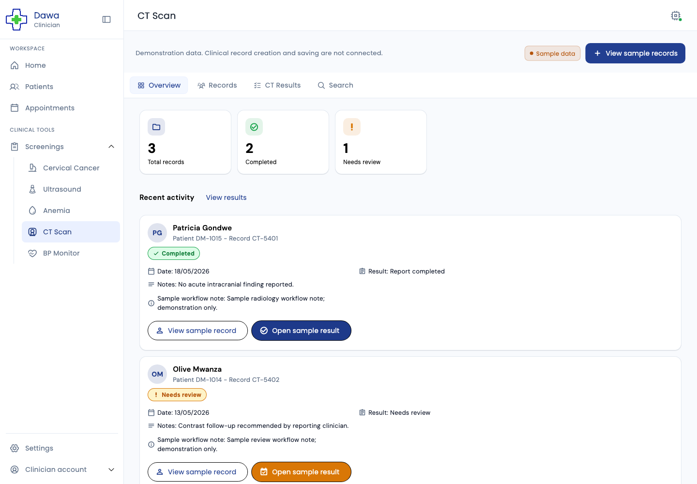

# Phase 10 — CT Scan UX refinement

## Current implementation assessment

CT Scan already uses the shared Dawa shell and the shared clinical dashboard. Its repository contains three local demonstration records; there is no production CT-record creation, persistence, image viewer, PACS/DICOM workflow, or AI inference service.

## Problems addressed

- A fourth sample metric implied follow-up tracking even though no such data exists.
- Demo radiology workflow text contained percentages and was rendered by a generic AI-confidence component, which could overstate its meaning.
- Sample-record actions behaved like navigation/filter operations rather than focused, read-only record viewing.
- Long record metadata could overflow on narrow, large-text layouts.
- Repeating sample labels on every record was visually noisy.

## Changes

- Retained the compact shared **Overview | Records | CT Results | Search** navigation and one CT Scan page identity.
- Kept the module-level **Sample data** status and explicit non-persistence description; removed unsupported follow-up tracking from the overview.
- Reworded sample workflow strings to remove faux confidence claims and render them as **Sample workflow note**, not AI output.
- Added focused read-only sample-record detail dialogs containing patient reference, record/date, saved result, radiology report text, and workflow note. The dialog clearly states that no clinical saving or review action is connected.
- Retained sample record search and filters, including patient reference and record ID matching.
- Made metadata rows flex safely at large text/mobile widths, eliminating the discovered overflow.
- Avoided repeating demo warnings per row; sample status is visible at the module level and within opened sample-record detail.

## Preserved contracts

No Supabase/auth/RLS/API/data-model/device/inference/radiology algorithm changes were made. The local sample repository remains local and no sample records are connected to production data.

## Verification

- CT navigation/responsive suite — 47 passed.
- `flutter analyze` — passed.
- `flutter build web --release` — passed.
- `git diff --check` — passed.

The CT checks are widget tests using demonstration records. They are not live backend, PACS, DICOM, or production-radiology verification.

## Desktop capture

