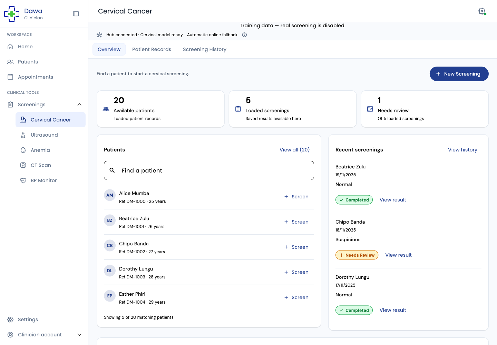
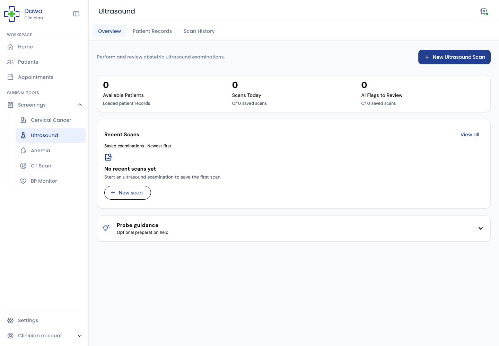
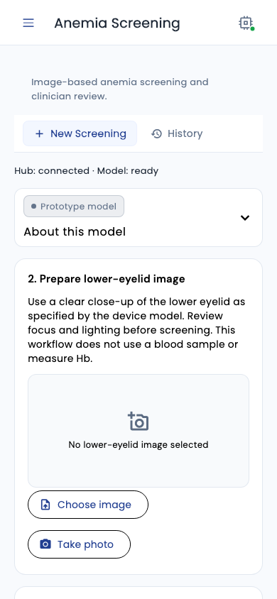
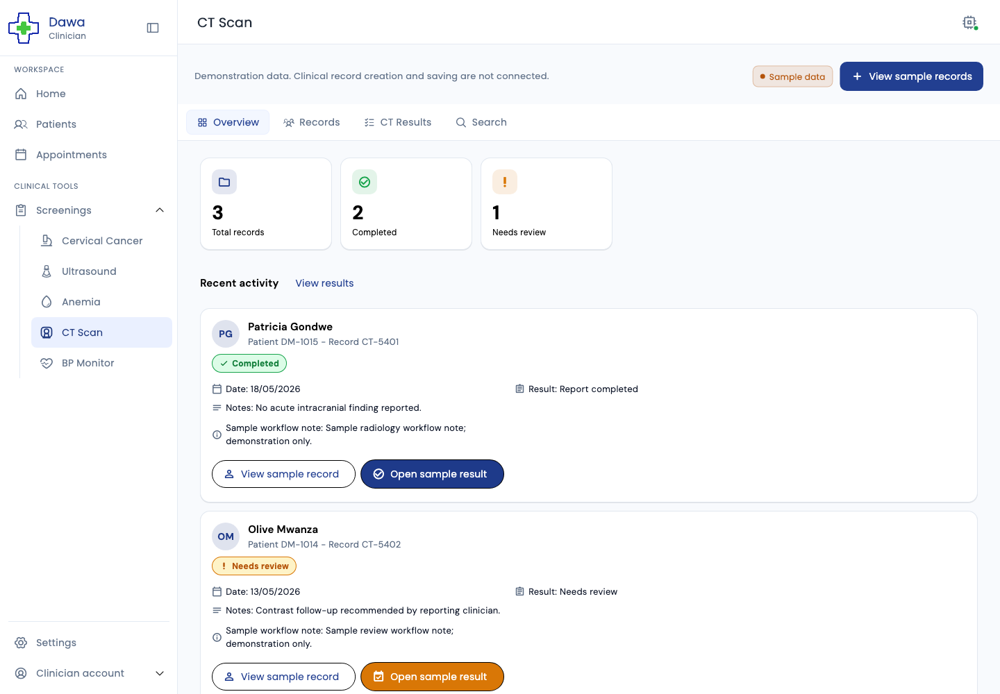

# Phase 6 — Clinical Workspace UX Refinement

## Outcome

Clinical workspaces now reserve their main canvas for clinical work. Routine
edge-device state is represented by the compact global device control; a
module only presents a local status notice when a clinician has started a
relevant examination and that state blocks the next step.

## Baseline findings

- Cervical Cancer repeated tab destinations as three prominent shortcut cards.
- Ultrasound repeated its record/history tabs as large dashboard actions and
  kept general probe guidance permanently expanded.
- CaCx, Ultrasound, and Anemia each rendered model connection/preparation as a
  persistent, full-width page element even when the clinician could still
  select a patient or prepare an image.
- Disabled local-analysis actions did not always explain the exact blocker.
- CT sample records needed a clearer non-clinical label.

## Changes

### Global edge-device status

- Kept the existing `EdgeDeviceManager` as the sole status source and retained
  its popover, diagnostics, last successful check, model and readiness fields.
- Reduced the app-bar control to a 40px icon-only button. Its tooltip and
  semantics expose connection and readiness without consuming header width.
- Preserved semantic colors, the restrained initialization motion and
  reduced-motion behavior. Retry remains disabled while an examination makes a
  hub check unsafe.

### Contextual device communication

- `EdgeWorkflowStatus` no longer renders routine connected, checking, ready,
  loading or unverified state as a persistent page banner.
- It only renders a compact in-workflow notice for a relevant blocked action:
  disconnected device, device/model error, another active examination, or an
  unsupported local model.
- Anemia and Ultrasound now state the reason for a disabled analysis action:
  missing patient/image, initializing model, disconnected device, active
  examination, or unavailable installation capability. No device state machine
  or request contract changed.

### Clinical workspace refinement

- **Cervical Cancer:** removed duplicate Patient Records/Results/History cards;
  tabs remain the single navigation route. The activity panel now uses a short
  empty state instead of a tall empty chart when there is no six-month activity.
  Its three desktop metrics now share the available workspace width rather than
  clustering on the left.
- **Ultrasound:** retained `New Ultrasound Scan` as the primary action; made
  AI-guided scanning a quiet secondary action; removed repeated patient/history
  shortcuts; moved probe guidance into a compact expandable helper.
- **Anemia:** retained the visible prototype/57.7% validation caution and
  two-column preparation layout, while adding explicit local-screening gate
  feedback and keeping the authorized empty-patient state truthful.
- **CT Scan:** changed the visible status to **Sample data** while preserving
  the existing non-persistent sample records, actions, and tabs.
- **BP Monitor:** reviewed as compliant with the requested two-column desktop
  workspace, labeled mmHg controls, clearly selected clinical-context chips,
  interpretation/history relationship, and session-only disclosure; no clinical
  logic was changed.

## Visual evidence

The responsive visual suite was regenerated and inspected at desktop, collapsed
sidebar, mobile, and 200% text scale. Representative current renders:

The review specifically checked compact app-bar placement, tabs, primary action
prominence, empty states, mobile drawer behavior, no clipped text, and no
layout exceptions.

## Functional preservation

No Supabase migration, schema, RLS policy, authentication flow, device API,
device-state transition, inference payload/response mapping, clinical threshold,
or persistence contract was changed. The implementation continues to use
`http://dawa.local` through the existing `EdgeDeviceManager` and client.

## Verification

- `flutter analyze` — clean.
- `flutter test --no-pub --concurrency=4` — **321 passed, 5 opt-in live tests
  skipped**.
- `flutter build web --release --no-pub` — passed (including Wasm dry run).
- `git diff --check` — clean.
- Focused device, Anemia, Ultrasound, CaCx, CT, BP, keyboard, mobile-drawer,
  collapsed-sidebar, and 200% text tests passed.

## Deliberate limitations

- The global device popover exposes actual manager state; it does not invent a
  separate connection service or claim model readiness from connectivity alone.
- CT remains a sample-data workflow and does not offer real record creation.
- Ultrasound and Anemia remain local-device workflows. Cervical Cancer retains
  its separately tested consented online second-opinion fallback from the prior
  phase.
