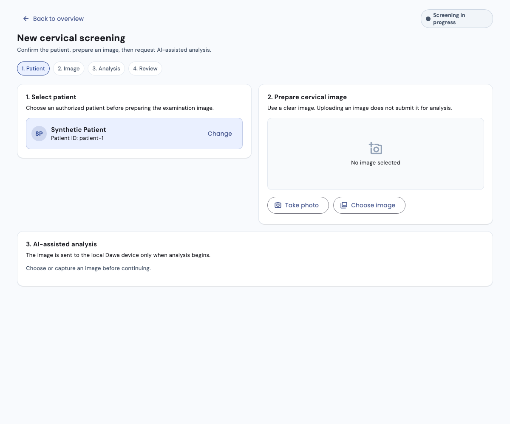

# Phase 7 — Cervical screening UX

## Problems addressed

The previous primary action opened an image picker and started analysis immediately. That made it too easy to enter a screening flow without first confirming the patient or local-model state. The result presentation also used the word “Diagnosis” for AI output, which could imply a clinical conclusion.

## Redesigned experience

- **Overview:** keeps the compact Cervical Cancer overview and its clear **New Screening** primary action; records and history remain available through the existing routes.
- **New Screening:** is now a dedicated, desktop-first examination workspace with a visible four-stage progress path: patient, image, analysis, and review.
- **Patient safety:** the clinician confirms the authorized patient before image preparation. Patient identity remains visible beside the image task and becomes locked once an image is prepared, preventing silent patient changes.
- **Image handling:** camera and gallery controls now prepare or replace an image without submitting it. The image is sent to the local Dawa device only when the clinician explicitly starts analysis.
- **Device state:** analysis readiness is contextual and comes from the existing `EdgeDeviceManager`. It explains initialization, disconnected, error, and busy states without a persistent global warning banner.
- **Results:** existing model result, confidence, recommendation, review, save, reopen, and image-inspection behavior are retained. The non-training heading now says **AI screening result**, not “Diagnosis”.
- **Second opinion:** the existing explicit-consent fallback remains available only after image preparation when local analysis is unavailable. Lack of internet keeps the image prepared and does not submit externally.

## Scope and contracts

No database schema, RLS/auth policy, backend endpoint, model/inference algorithm, device configuration, or persistence contract changed. The local device and optional online second-opinion paths continue to use their existing services.

## Verification

- `flutter analyze` — passed, no issues.
- `flutter test --no-pub` — passed (full repository suite; opt-in live checks remain excluded by their existing guards).
- Targeted UX suite — 63 checks passed across CaCx second-opinion safety, all five clinical workspaces, desktop/collapsed/mobile/large-text layouts, and navigation retention.
- `flutter build web --release` — passed.
- `git diff --check` — passed.

The second-opinion, persistence, and edge-device tests are mocked integration/widget checks. They do not constitute live Supabase or physical-device verification.

## Visual review

The new workspace was captured at 1200 × 1000 and inspected for desktop spacing, alignment, control size, image-area affordance, and unnecessary device banners. It has no overflow or overlapping controls.

For the prior compact overview reference, see [the Phase 5 desktop capture](qa/phase5/cacx-desktop.png).
