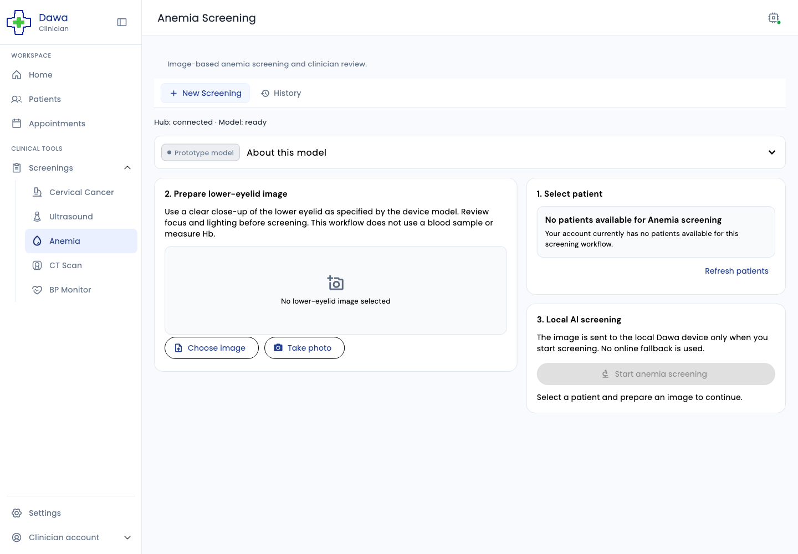

# Phase 9 — HemoNix Anemia Screening UX

## Problems addressed

- Device and workflow errors could dominate the page instead of appearing at the blocked action.
- The unavailable-patient state did not give enough context or recovery guidance.
- Image preparation lacked an inspection area and clear replacement/removal feedback.
- AI estimates, probabilities, and clinician review were visually too close together.
- History rows did not make saved examinations easy to reopen.

## Redesigned workflow

- Keeps the shared **Anemia Screening** page identity and compact New Screening / History tabs.
- Shows the prototype limitation once, in a restrained but visible warning panel.
- Uses a patient/image desktop pair with a persistent selected-patient summary.
- Provides an aspect-ratio-preserving lower-eyelid image preview and real Choose, Replace, Retake, and Remove actions. Image selection does not submit to the device.
- Presents device/readiness and error information only near **Start anemia screening**, while the global app-bar control retains overall connection status and diagnostics.
- Places submitted image beside neutral AI-estimate and probability details at desktop widths. The UI calls it an experimental estimate, never a diagnosis or Hb value.
- Separates Clinician Review and save requirements from AI output.
- Uses compact saved-history rows and reopens actual stored results/probabilities/review notes without rerunning inference.

## Preserved contracts

No change was made to Supabase schema/RLS/auth, authorized patient loading, `EdgeDeviceManager`, NiADA selection/inference, image preprocessing, result validation, examination IDs, or review-saving operations.

The observed technical device message `Future not completed` is not surfaced to clinicians by this UI. If the device manager produces it, diagnostics should be used to investigate the asynchronous integration; no model-management behavior was bypassed here.

## Verification

- `flutter test --no-pub test/anemia_workflow_test.dart` — 16 passed.
- Responsive clinical visual suite — 41 passed across desktop, collapsed, mobile, and large-text layouts.
- `flutter analyze` — passed.
- `flutter build web --release` — passed.
- `git diff --check` — passed.

Tests use mocked edge-device and repository behavior. They validate UI state, result handling, and safety guards, but are not physical-device or live-Supabase verification.

## Desktop capture

