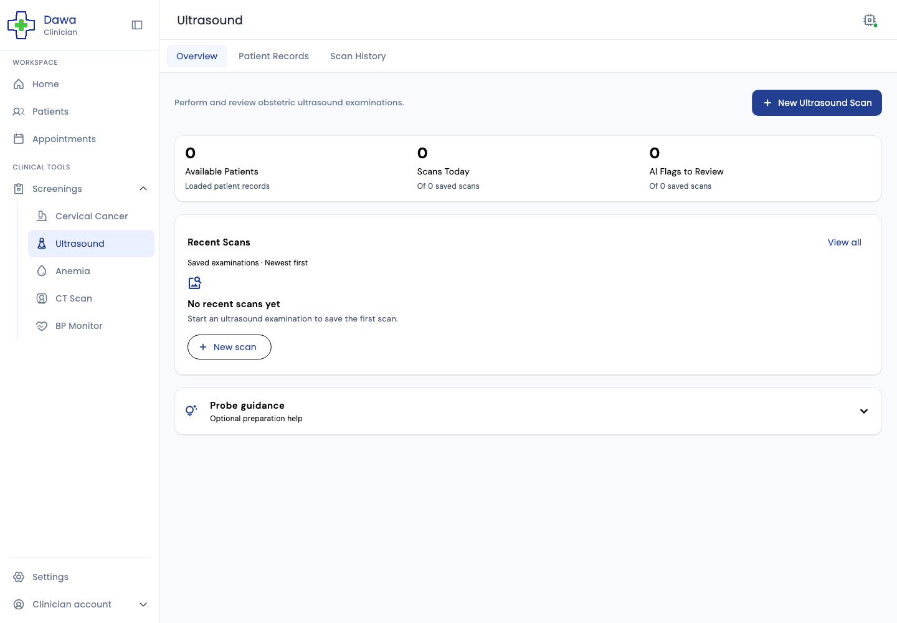

# Ultrasound module UI/UX refinement

## Problems found

- The overview offered both a primary scan action and a second competing AI action.
- Selecting an image immediately began inference, leaving little opportunity to confirm the patient, image, or device state.
- The former AI screen described a live sweep/probe workflow even though the verified AI contract accepts an uploaded image.
- Patient rows repeated unavailable fields and launched a new scan instead of opening a patient record.
- Scan history did not provide a clear, read-only way to inspect a saved examination.

## Changes

- Consolidated the overview around **New Ultrasound Scan**, compact verified metrics, recent scans, and optional probe guidance.
- Reworded the scan-mode choice to describe AI mode accurately: image upload for AI-assisted segmentation and measurement.
- Rebuilt the AI workspace as a desktop-first upload workflow with patient context, aspect-ratio-preserving image preview, choose/replace/remove controls, and a separate **Analyze Ultrasound Image** action.
- Image selection now only prepares the image; it never starts inference automatically.
- Retained the existing edge-device manager and contextual readiness gating. There is no new device service or permanent connection banner.
- Added patient-specific ultrasound records, keeping unique patient IDs and each saved examination separate.
- Added read-only saved-scan detail sheets. They show only persisted data and never rerun AI.
- Clarified result language as AI-returned measurements and model-reported gestational age. Existing segmentation values, pixel units, calibration notice, review, and save actions remain unchanged.

## Preserved contracts

No schema, Supabase/RLS, authentication, model endpoint, inference request/response parsing, measurement, or persistence changes were made. The existing `UltrasoundRepository`, `UltrasoundEdgeService`, picker, and `EdgeDeviceManager` remain the sources of truth.

## Verification

- `flutter analyze` — passed.
- `flutter test --no-pub test/ultrasound_empty_data_test.dart test/ultrasound_initialization_test.dart` — 15 passed.
- `flutter test --no-pub --update-goldens --dart-define=CAPTURE_CLINICAL_PHASE5=true test/clinical_phase5_review_test.dart` — 41 passed across desktop, collapsed, mobile, and large-text layouts.
- `git diff --check` — passed.

Automated checks use test doubles for repository and edge-device behavior. Live Supabase authorization and physical UltraSam-device validation still require the deployed environment.

## Visual reference

